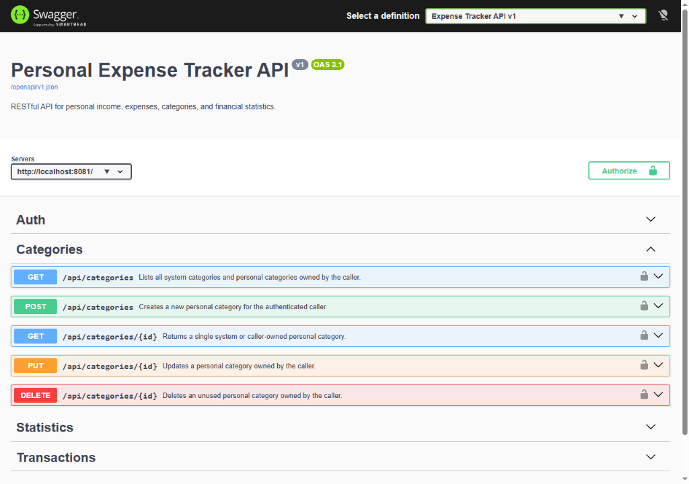
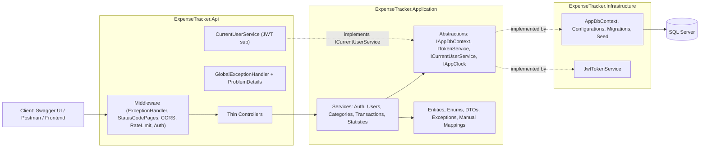
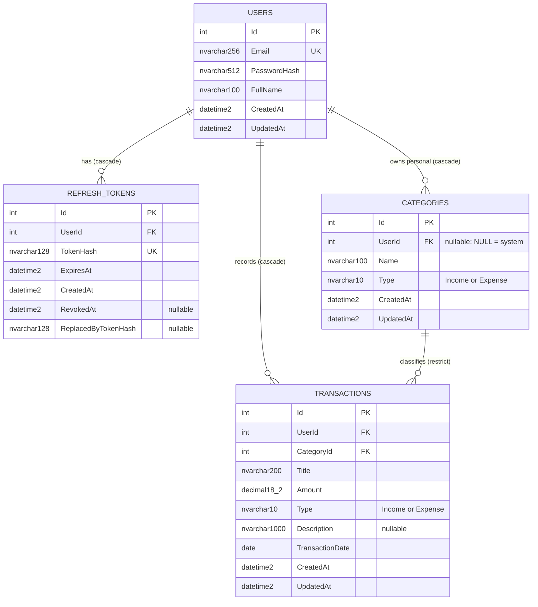

# Personal Expense Tracker API

[](https://github.com/dangbinhduongwork-ai/personal-expense-tracker-api/actions/workflows/ci.yml)


[](LICENSE)

RESTful backend API for personal income and expense tracking, built with **ASP.NET Core 10 LTS (Controllers)**, **Entity Framework Core 10 (Code First)**, **SQL Server**, **JWT Authentication (HS256 + Rotating SHA-256 Refresh Tokens)**, **xUnit v3**, and **Testcontainers**.

---

## Engineering Highlights

* **25 RESTful Endpoints** across Auth, Categories, Transactions, Statistics, and Health — unified behind **RFC 9457 `ProblemDetails`** (`code` + `traceId`) and `.NET 10` OpenAPI 3.1 + Swagger UI.
* **147 Automated Tests Passing** (`50` unit + `97` integration against **real SQL Server via Testcontainers.MsSql**) with **0 compiler warnings** (`-warnaserror`) and **0 vulnerable NuGet dependencies**.
* **SQL-Side Financial Analytics (< 10 ms on 10,000 rows):** SARGable `DateOnly` filters and `GROUP BY`/`SUM` aggregations execute directly in SQL Server, keeping `decimal(18,2)` arithmetic exact with `MidpointRounding.AwayFromZero` percentages.
* **Defense-in-Depth Security:** JWT `sub`-only identity resolution, single-query `UserId` scoping returning `404` on foreign resources (BOLA/IDOR isolation), constant-time PBKDF2 login parity, SHA-256 rotating refresh tokens with concurrency-safe replay-theft family revocation, and `Retry-After` rate limiting on auth endpoints.
* **Documented Architecture:** Every key trade-off is captured in [Architecture Decision Records (`docs/decisions/`)](docs/decisions/0001-tech-stack.md) and technical design specs (`docs/design/`).

---

## API Preview (Swagger UI)



---

## Features

* **Authentication & Profile:** Register, login (constant-time PBKDF2 parity), rotating SHA-256 refresh tokens with replay-theft family revocation, idempotent owner-scoped logout, profile updates, and password changes (revoking all active refresh tokens).
* **Category Management:** 12 seeded read-only system categories (`Food`..`Bills`, `Salary`..`Other Income`) plus personal category CRUD enforcing ownership isolation (`404`) and in-use protection (`409 category_in_use`).
* **Transaction Management:** Full CRUD with strict decimal money validation (`decimal(18,2)`, `0.01..1e12`, `<= 2` dp), `DateOnly` calendar dates, multi-criteria filtering (`type`, `categoryId`, `from`/`to`), literal parameterized `search`, whitelist sorting (`date|amount|title`), and `Id` tie-broken deterministic paging.
* **Financial Statistics:** 7 SQL-aggregated analytics endpoints (`summary`, `daily`, `monthly`, `yearly`, `categories`, `top-categories`, `comparison`) with SARGable `DateOnly` range filters, zero-filling for empty periods, and `MidpointRounding.AwayFromZero` percentages.
* **Security & Reliability:** `[Authorize]` + `FallbackPolicy`, strict JWT algorithm/issuer/audience/clock-skew checks, rate limiting on auth routes (`429 rate_limited`), uniform RFC 9457 `ProblemDetails` across all non-2xx statuses (including non-JSON `Accept` fallback), `X-Content-Type-Options: nosniff`, `Cache-Control: no-store`, strict CORS, and `OpenApi:EnableUi` gating.

---

## Architecture



## Database ERD



---

## Tech Stack

| Component | Technology | Notes |
|---|---|---|
| Runtime & API | `.NET 10 LTS` (`net10.0`), ASP.NET Core Controllers | Built-in `.NET 10` OpenAPI + Swagger UI (`Swashbuckle.AspNetCore.SwaggerUI`) |
| Persistence | EF Core 10 Code First + SQL Server | Explicit fluent config, `decimal(18,2)`, native `DateOnly` |
| Auth & Security | `JwtBearer`, `JsonWebTokenHandler` (HS256), `PasswordHasher<User>` | SHA-256 hashed rotating refresh tokens, `TimeProvider` |
| Testing | xUnit v3 (`Microsoft.Testing.Platform`), Moq, `FakeTimeProvider`, `WebApplicationFactory`, `Testcontainers.MsSql` | Real SQL Server integration + security test suite (`SEC-01..25`) |
| Containers & CI | Docker multi-stage (`sdk:10.0` / `aspnet:10.0`), Docker Compose, GitHub Actions | Non-root container user, SQL Server healthcheck |

---

## Quickstart

### Option A: Windows Local (User-Secrets + LocalDB or SQL Server)

1. **Restore local EF Core CLI tool and packages:**
   ```powershell
   dotnet tool restore
   dotnet restore
   ```
2. **Configure user-secrets (never commit secrets):**
   ```powershell
   $bytes = New-Object byte[] 48; [System.Security.Cryptography.RandomNumberGenerator]::Create().GetBytes($bytes)
   $jwtKey = [Convert]::ToBase64String($bytes)
   dotnet user-secrets set "Jwt:Key" "$jwtKey" --project src/ExpenseTracker.Api
   dotnet user-secrets set "ConnectionStrings:DefaultConnection" "Server=(localdb)\MSSQLLocalDB;Database=ExpenseTrackerDb;Trusted_Connection=True;TrustServerCertificate=True" --project src/ExpenseTracker.Api
   ```
3. **Apply EF Core migrations and run:**
   ```powershell
   dotnet tool run dotnet-ef database update --project src/ExpenseTracker.Infrastructure --startup-project src/ExpenseTracker.Api
   dotnet run --project src/ExpenseTracker.Api
   ```
   * Health check: `http://localhost:5291/health`
   * Swagger UI (Development): `http://localhost:5291/swagger`
   * OpenAPI JSON: `http://localhost:5291/openapi/v1.json` (exported snapshot: [docs/api/openapi.v1.json](docs/api/openapi.v1.json))

### Option B: Docker Compose (One-Command Run)

1. **Create `.env` from `.env.example`** (set a strong `MSSQL_SA_PASSWORD` and a random Base64 `JWT_KEY` ≥ 32 decoded bytes; never commit `.env`).
2. **Start API + SQL Server and run the smoke test:**
   ```powershell
   docker compose up --build -d
   powershell -ExecutionPolicy Bypass -File scripts/smoke.ps1 -BaseUrl http://localhost:8080
   # Open http://localhost:8080/swagger or http://localhost:8080/health
   docker compose down -v
   ```
   See [docs/DEPLOYMENT.md](docs/DEPLOYMENT.md) for full configuration and troubleshooting details.

---

## Configuration Reference

| Key (`appsettings` / Env Var) | Dev Default | Compose / Production |
|---|---|---|
| `ConnectionStrings__DefaultConnection` | `user-secrets` | `.env` / Env var (required) |
| `Jwt__Key` | `user-secrets` (≥ 32 decoded bytes Base64) | `.env` / Env var (required; fails fast if shorter) |
| `Jwt__Issuer` / `Jwt__Audience` | `ExpenseTracker.Api` / `ExpenseTracker.Client` | Override as needed |
| `Jwt__AccessTokenMinutes` / `RefreshTokenDays` | `15` / `7` | `15` / `7` |
| `Cors__AllowedOrigins__0` | `http://localhost:3000`, `http://localhost:5173` | Explicit origin list (`[]` blocks cross-origin; `*` forbidden) |
| `AllowedHosts` | `*` (dev) | `localhost;127.0.0.1` in compose; explicit domain in prod |
| `App__TimeZoneId` | `Asia/Ho_Chi_Minh` | Same (Windows fallback handled by `AppClock`) |
| `Database__MigrateOnStartup` | `false` | `true` in local compose demo |
| `HttpsRedirection__Enabled` | `false` (dev) | `false` for local HTTP compose; `true` behind TLS |
| `OpenApi__EnableUi` | `true` (dev) | `false` default (`true` in `.env.example` for local Compose demo) |
| `Seed__DemoData` | `false` | `false` (ignored outside `Development`) |
| `RateLimiting__PermitLimit` | `10` per `60s` (`RemoteIpAddress`) | `10` per `60s` |

---

## API Overview (`25` Endpoints)

| Group | Endpoints | Auth |
|---|---|---|
| **Health** | `GET /health` | Anonymous |
| **Auth** | `POST /api/auth/register`, `POST /api/auth/login`, `POST /api/auth/refresh-token`, `POST /api/auth/logout`, `GET /api/auth/me`, `PUT /api/auth/profile`, `PUT /api/auth/change-password` | Anonymous (`register`/`login`/`refresh-token`), Bearer (others), rate-limited on mutations |
| **Categories** | `GET /api/categories?type=`, `GET /api/categories/{id}`, `POST /api/categories`, `PUT /api/categories/{id}`, `DELETE /api/categories/{id}` | Bearer |
| **Transactions** | `GET /api/transactions`, `GET /api/transactions/{id}`, `POST /api/transactions`, `PUT /api/transactions/{id}`, `DELETE /api/transactions/{id}` | Bearer |
| **Statistics** | `GET /api/statistics/{summary,daily,monthly,yearly,categories,top-categories,comparison}` | Bearer |

A Postman v2.1 collection and local environment are provided under [postman/](postman/).

---

## Running Tests

Docker Desktop (or `TEST_SQL_CONNECTION` pointing to SQL Server) is used for integration tests via Testcontainers:

```powershell
dotnet build -c Release -warnaserror
dotnet test -c Release --no-build
dotnet list package --vulnerable --include-transitive
```

---

## Project Structure

```text
├── src/
│   ├── ExpenseTracker.Api/            # Controllers, Middleware, ProblemDetails, OpenAPI, Program.cs
│   ├── ExpenseTracker.Application/    # Entities, Enums, DTOs, Abstractions, Services, Mappings
│   └── ExpenseTracker.Infrastructure/ # AppDbContext, EF Configs, Migrations, Seed, JwtTokenService
├── tests/
│   ├── ExpenseTracker.UnitTests/      # Service unit tests (Moq, FakeTimeProvider, EF InMemory)
│   └── ExpenseTracker.IntegrationTests/# End-to-end API, SQL, Performance (10k), Security tests
├── postman/                           # Postman collection v2.1 + local environment
├── scripts/smoke.ps1                  # End-to-end HTTP smoke check script
├── docs/                              # Design docs, ADRs, OpenAPI snapshot, screenshots, deployment guide
├── Dockerfile
├── docker-compose.yml
├── LICENSE
└── .github/workflows/ci.yml
```

## Documentation & Architecture Decision Records (ADRs)

* **Design Specs:** [Requirements](docs/design/requirements.md) · [Architecture](docs/design/architecture.md) · [Database ERD](docs/design/database-erd.md) · [API Specification](docs/design/api-specification.md) · [Security Design](docs/design/security.md) · [Testing Strategy](docs/design/testing.md) · [Deployment Guide](docs/DEPLOYMENT.md)
* **ADRs:** [0001 Tech Stack](docs/decisions/0001-tech-stack.md) · [0002 Three-Project Architecture](docs/decisions/0002-three-project-architecture.md) · [0003 Direct `IAppDbContext`](docs/decisions/0003-no-repository-pattern.md) · [0004 Controllers & Manual Mapping](docs/decisions/0004-controllers-dataannotations-manual-mapping.md) · [0005 `ProblemDetails` & Plain DTOs](docs/decisions/0005-problemdetails-and-plain-dtos.md) · [0006 `DateOnly` & UTC](docs/decisions/0006-dateonly-and-utc-timestamps.md) · [0007 `int` Keys & `404` Ownership](docs/decisions/0007-int-keys-and-404-ownership.md) · [0008 JWT & Rotating Refresh Tokens](docs/decisions/0008-jwt-and-rotating-refresh-tokens.md) · [0009 OpenAPI & Swagger UI](docs/decisions/0009-openapi-and-swagger-ui.md) · [0010 Two-Layer Testing](docs/decisions/0010-testing-strategy-inmemory-and-sqlserver.md)

## Security & Roadmap Notes

* Strict BOLA isolation (`404` on foreign resources, `403` on system categories), JWT HS256 pinning, SHA-256 refresh rotation & replay detection, parameterized EF LINQ, zero secrets in Git/images, `nosniff`, `Retry-After` on rate limits, and RFC 9457 `ProblemDetails`. Known trade-offs are documented in [docs/design/security.md](docs/design/security.md) §13.
* **Planned enhancements:** monthly budgets, CSV export, and recurring transactions.
* **License:** [MIT](LICENSE).
