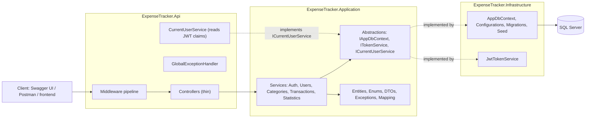

# System Architecture

## 1. Component diagram



## 2. Projects and dependency rule

| Project | Contains | May reference | Must NOT reference |
|---|---|---|---|
| `ExpenseTracker.Application` | Entities, Enums, DTOs, service interfaces + implementations, abstractions, exceptions, mapping | EF Core (no provider), `Microsoft.Extensions.Identity.Core`, logging abstractions | Infrastructure, Api, ASP.NET Core packages, SqlServer provider |
| `ExpenseTracker.Infrastructure` | `AppDbContext`, entity configurations, migrations, seed, `JwtTokenService`, `JwtOptions` | Application, EF Core SqlServer, JsonWebTokens | Api |
| `ExpenseTracker.Api` | Controllers, `Program.cs`, middleware/handlers, `CurrentUserService`, DI/OpenAPI/auth setup | Application, Infrastructure (only to register services) | — |
| `ExpenseTracker.UnitTests` | Service tests (Moq + EF InMemory) | Application, Infrastructure (to use `AppDbContext`) | Api |
| `ExpenseTracker.IntegrationTests` | HTTP-level tests with `WebApplicationFactory<Program>` + real SQL Server | Api (+ transitive) | — |

**Why not 4 projects (separate Domain)?** Entities are plain classes; a fourth project adds ceremony without extra architectural value here. They live in `Application/Entities` (see [ADR-0002](../decisions/0002-three-project-architecture.md)).

## 3. Folder layout

```
ExpenseTracker.slnx
global.json
Directory.Build.props             (Nullable, ImplicitUsings, TreatWarningsAsErrors in Release/CI)
Directory.Packages.props          (central package versions)
.editorconfig  .gitignore  .env.example  Dockerfile  docker-compose.yml  README.md
docs/{api,decisions,design}/
src/
  ExpenseTracker.Application/
    Abstractions/   IAppDbContext.cs  ICurrentUserService.cs  ITokenService.cs  IAppClock.cs
    Common/         AppClock.cs  DbUpdateExceptionExtensions.cs  PasswordRuleValidator.cs
    Entities/       User.cs  RefreshToken.cs  Category.cs  Transaction.cs
    Enums/          TransactionType.cs
    Dtos/           Auth/  Users/  Categories/  Transactions/  Statistics/  Common/(PagedResult.cs)
    Exceptions/     AppException.cs  NotFoundException.cs  ConflictException.cs  BusinessRuleException.cs  ForbiddenException.cs  UnauthorizedException.cs  ValidationFailedException.cs
    Mapping/        CategoryMappings.cs  TransactionMappings.cs  UserMappings.cs
    Services/       Auth/  Users/  Categories/  Transactions/  Statistics/   (I*Service.cs + *Service.cs per folder)
    DependencyInjection.cs          (AddApplication, IAppClock)
  ExpenseTracker.Infrastructure/
    Data/           AppDbContext.cs  Configurations/  Migrations/  Seed/
    Auth/           JwtOptions.cs  JwtTokenService.cs
    DependencyInjection.cs          (AddInfrastructure)
  ExpenseTracker.Api/
    Controllers/    AuthController.cs  CategoriesController.cs  TransactionsController.cs  StatisticsController.cs
    ExceptionHandling/ GlobalExceptionHandler.cs  ProblemDetailsResponseWriter.cs
    Health/         DatabaseHealthCheck.cs
    ModelBinding/   StrictStringEnumModelBinder.cs  StrictStringEnumModelBinderProvider.cs
    Options/        AppOptions.cs  CorsOptions.cs  DatabaseOptions.cs  HttpsRedirectionOptions.cs  OpenApiOptions.cs  RateLimitingOptions.cs  SeedOptions.cs
    Services/       CurrentUserService.cs
    Extensions/     AuthenticationExtensions.cs  OpenApiExtensions.cs  CorsExtensions.cs  RateLimitingExtensions.cs
    Program.cs  appsettings.json  appsettings.Development.json
tests/
  ExpenseTracker.UnitTests/         Services/
  ExpenseTracker.IntegrationTests/  Infrastructure/(SqlServerFixture, ApiFactory, AuthHelper)  Auth/  Categories/  Transactions/  Statistics/  Security/  Errors/  Cors/  Conventions/  Smoke/
```

## 4. Request flow (one example: `POST /api/transactions`)

1. Middleware pipeline (order matters): Security headers (`X-Content-Type-Options: nosniff`) → `UseExceptionHandler` → conditional `UseHttpsRedirection` + `UseHsts` (outside Development when `HttpsRedirection:Enabled` is `true`; `false` in HTTP Docker demo and test host) → `UseCors` → `UseRateLimiter` → `UseAuthentication` → `UseAuthorization` → `MapControllers` / anonymous `GET /health` (+ conditional `MapOpenApi` / `UseSwaggerUI` when `OpenApi:EnableUi` is `true`).
2. `TransactionsController.Create([FromBody] CreateTransactionRequest)` — `[Authorize]` ensures a valid JWT; `[ApiController]` runs DataAnnotations → automatic 400 `ValidationProblemDetails` (with `code: "validation_failed"` via customized `InvalidModelStateResponseFactory`) for shape errors.
3. Controller calls `ITransactionService.CreateAsync(request, ct)` and returns `CreatedAtAction(...)` with a `TransactionDto`. **No EF, no rules in the controller.**
4. `TransactionService` gets `userId` from `ICurrentUserService`, loads the category (`system OR owned by user`), applies BR-03/04/05 (using `IAppClock.Today`), creates the entity with `UserId = userId`, `CreatedAt/UpdatedAt = clock.UtcNow`, saves, maps to DTO.
5. Rule violations throw `BusinessRuleException` / `ValidationFailedException` / `NotFoundException` / `ConflictException` / `ForbiddenException` / `UnauthorizedException`; `GlobalExceptionHandler` converts them to `ProblemDetails` (status + `code`). Unknown exceptions → 500 with a generic message (no stack trace outside Development) and are logged.

## 5. Key abstractions

```csharp
// Application/Abstractions
public interface IAppDbContext
{
    DbSet<User> Users { get; }
    DbSet<RefreshToken> RefreshTokens { get; }
    DbSet<Category> Categories { get; }
    DbSet<Transaction> Transactions { get; }
    Task<int> SaveChangesAsync(CancellationToken cancellationToken);
    Task<bool> CanConnectAsync(CancellationToken cancellationToken); // used by GET /health
    void ClearChangeTracker();
    Task<int> RevokeAllActiveTokensForUserAsync(int userId, DateTime revokedAtUtc, CancellationToken cancellationToken);
}
public interface ICurrentUserService { int UserId { get; } }      // validates int sub > 0; else UnauthorizedException
public interface IAppClock
{
    TimeZoneInfo AppTimeZone { get; }                            // resolved at startup from App:TimeZoneId
    DateTime UtcNow { get; }                                     // TimeProvider.GetUtcNow().UtcDateTime
    DateOnly Today { get; }                                      // DateOnly in AppTimeZone
}
public interface ITokenService
{
    AccessToken CreateAccessToken(User user);                      // JWT + expiry
    RefreshTokenValue CreateRefreshToken();                        // raw token, SHA-256 hash, ExpiresAt (UTC)
    string HashRefreshToken(string rawToken);                      // SHA-256 → hex
}
```

Services: `IAuthService` (register, login, refresh, logout), `IUserService` (me, update profile, change password), `ICategoryService`, `ITransactionService`, `IStatisticsService`. Every method is `async` and takes a `CancellationToken`.

## 6. Cross-cutting concerns

| Concern | Decision |
|---|---|
| Configuration | `appsettings.json` (non-secret defaults) → `appsettings.Development.json` → **user-secrets** (dev) → **environment variables** (`Jwt__Key`, `ConnectionStrings__DefaultConnection`). Options classes validated at startup (`ValidateDataAnnotations().ValidateOnStart()`); `Jwt:Key` decoded Base64 ≥ 32 bytes and `App:TimeZoneId` resolved at startup or the app refuses to start. |
| Keys | `ConnectionStrings:DefaultConnection`, `Jwt:Issuer`, `Jwt:Audience`, `Jwt:Key`, `Jwt:AccessTokenMinutes` (15), `Jwt:RefreshTokenDays` (7), `Cors:AllowedOrigins[]`, `App:TimeZoneId` (`Asia/Ho_Chi_Minh`, fallback `"SE Asia Standard Time"`), `Database:MigrateOnStartup` (false; true in docker-compose), `Seed:DemoData` (false; Development-only), `OpenApi:EnableUi` (true in Development, false elsewhere unless set), `HttpsRedirection:Enabled` (true outside Development; false in HTTP Docker demo/tests), `RateLimiting:PermitLimit` (10) & `RateLimiting:WindowSeconds` (60) |
| Time | All `CreatedAt/UpdatedAt/ExpiresAt/RevokedAt` are UTC `DateTime` (`TimeProvider.GetUtcNow().UtcDateTime`) mapped to `datetime2`. `TransactionDate` is a calendar `DateOnly` (`date`). `IAppClock` converts UTC to `App:TimeZoneId` for "today". `JwtBearerOptions.TimeProvider` is wired from DI `TimeProvider` so `FakeTimeProvider` integration tests validate tokens consistently. |
| Validation | Shape: DataAnnotations on request DTOs (`[Required]` on nullable value types `TransactionType?`/`DateOnly?`/`decimal?`/`int?`, `[StringLength]`, `[Range]`, `[EnumDataType]`), plus custom query-string enum `IModelBinder` rejecting integers. Business: in services (including `ValidationFailedException`). |
| Errors | `IExceptionHandler` + `AddProblemDetails()` + `InvalidModelStateResponseFactory` + `JwtBearerEvents.OnChallenge` (`401 unauthorized`) / `OnForbidden` (`403 forbidden`) + `RateLimiterOptions.OnRejected` (`429 rate_limited`); `code` and `traceId` on every non-2xx JSON response. |
| Logging | `ILogger<T>` with message templates (`"Created transaction {TransactionId} for user {UserId}"`). Never log secrets, `Authorization` headers, connection strings, passwords, tokens, or full request bodies. |
| JSON | `System.Text.Json`, camelCase, enums as strings (`JsonStringEnumConverter(allowIntegerValues: false)`), dates `yyyy-MM-dd` via `DateOnly`. |
| CORS | Named policy from `Cors:AllowedOrigins`; empty list = no cross-origin access. Never `AllowAnyOrigin` / `"*"` with credentials or in non-Dev configs. |
| Rate limiting | Built-in `AddRateLimiter`, fixed window partitioned by `HttpContext.Connection.RemoteIpAddress` (ignoring untrusted `X-Forwarded-For`), covering `register`, `login`, `refresh-token`, `logout`, `change-password` (`RejectionStatusCode = 429` + `Retry-After` header + `ProblemDetails` `code: "rate_limited"`). |
| Health | `GET /health` (anonymous via `.AllowAnonymous()`) — liveness + `IAppDbContext.CanConnectAsync`, returning `200 Healthy` or generic `503 Unhealthy` without internal error text. |
| OpenAPI | `AddOpenApi` + document transformer adding the `Bearer` JWT scheme; **both** `MapOpenApi()` and `UseSwaggerUI()` (`/swagger` + `/openapi/v1.json`) gated behind `OpenApi:EnableUi == true`. |
| EF usage | Read queries `AsNoTracking()`, projections with `Select` to DTOs, always filter by `UserId`; no lazy loading; no N+1. Keep SARGable predicates (direct equality on normalized `Email`, `DateOnly` range predicates `>= from && <= to`), forbid unescaped `EF.Functions.Like`, use `IAppDbContext.RevokeAllActiveTokensForUserAsync` (`ExecuteUpdateAsync` on relational DBs with InMemory fallback), and map unique-index/FK `DbUpdateException` (SQL 2601/2627/547) cleanly. |

## 7. Architectural decision records

| ADR | Decision |
|---|---|
| [0001](../decisions/0001-tech-stack.md) | Tech stack: .NET 10 LTS |
| [0002](../decisions/0002-three-project-architecture.md) | 3 src projects; entities inside Application |
| [0003](../decisions/0003-no-repository-pattern.md) | No Repository pattern; services use `IAppDbContext` |
| [0004](../decisions/0004-controllers-dataannotations-manual-mapping.md) | Controllers, DataAnnotations, manual mapping |
| [0005](../decisions/0005-problemdetails-and-plain-dtos.md) | ProblemDetails for all errors; success responses are plain DTOs |
| [0006](../decisions/0006-dateonly-and-utc-timestamps.md) | `DateOnly` for `TransactionDate`; UTC for audit timestamps |
| [0007](../decisions/0007-int-keys-and-404-ownership.md) | int identity keys; foreign resources → 404 |
| [0008](../decisions/0008-jwt-and-rotating-refresh-tokens.md) | JWT access (15 min) + hashed rotating refresh tokens (7 days), JSON body transport |
| [0009](../decisions/0009-openapi-and-swagger-ui.md) | OpenAPI generator + Swagger UI choice |
| [0010](../decisions/0010-testing-strategy-inmemory-and-sqlserver.md) | Test strategy: InMemory for unit tests, real SQL Server (Testcontainers) for integration tests |

## 8. Things deliberately NOT done (and why)

Repository/UnitOfWork (EF Core already is one), CQRS/MediatR (no benefit at this size), AutoMapper (hides logic), DDD aggregates (anemic entities are fine here), microservices, caching, background jobs.
