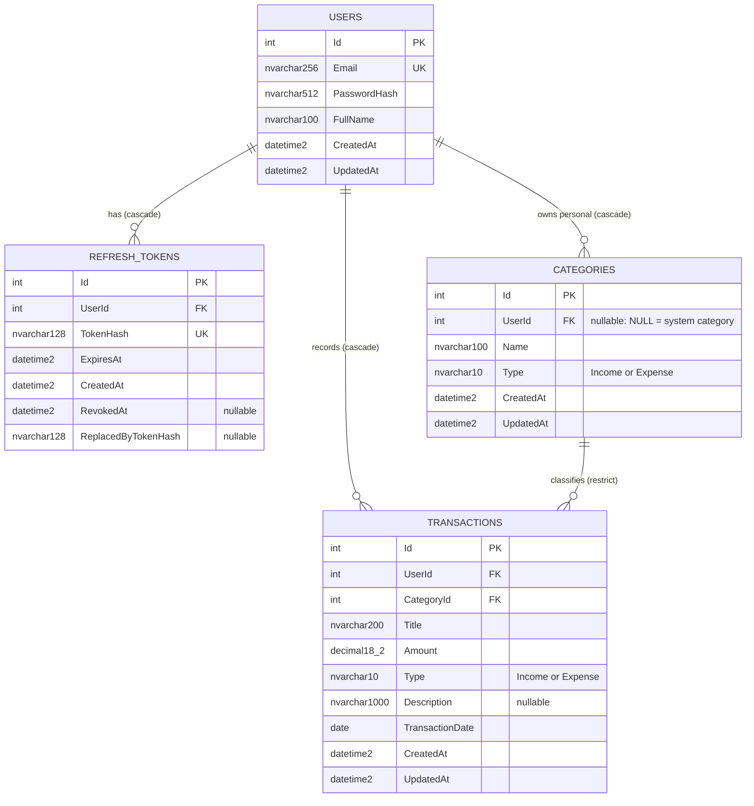

# Database Design (SQL Server, EF Core Code First)

## 1. ERD

## 2. Relationships

| Relationship | Cardinality | On delete | Why |
|---|---|---|---|
| Users → RefreshTokens | 1 : N | Cascade | Tokens have no meaning without the user. |
| Users → Categories (personal) | 1 : N (optional) | Cascade | Personal categories die with the user. System categories have `UserId = NULL`. *(Must configure `.OnDelete(DeleteBehavior.Cascade)` explicitly to override EF Core's `ClientSetNull` default for optional FKs.)* |
| Users → Transactions | 1 : N | Cascade | Data of a deleted user must not linger. (No delete-account endpoint in v1; if added later, delete the user's `Transactions` before deleting the `User` row so `Categories -> Transactions (Restrict)` cannot conflict.) |
| Categories → Transactions | 1 : N | **Restrict** (`NO ACTION` in SQL Server) | A category in use cannot be removed (BR-09). Maps to `ON DELETE NO ACTION` in SQL Server so `Transactions` has only one cascade path from `Users` (avoids SQL Server `Msg 1785`). |

## 3. Tables

### Users
| Column | Type | Null | Constraints |
|---|---|---|---|
| Id | int identity | no | PK |
| Email | nvarchar(256) | no | **Unique index** `UX_Users_Email` (default CI collation ⇒ case-insensitive). App also lower-cases/trims. |
| PasswordHash | nvarchar(512) | no | Output of `PasswordHasher<User>` (never the password) |
| FullName | nvarchar(100) | no | |
| CreatedAt / UpdatedAt | datetime2 | no | UTC |

### RefreshTokens
| Column | Type | Null | Constraints |
|---|---|---|---|
| Id | int identity | no | PK |
| UserId | int | no | FK → Users, cascade; index `IX_RefreshTokens_UserId` |
| TokenHash | nvarchar(128) | no | **Unique** `UX_RefreshTokens_TokenHash` — SHA-256 (hex) of the raw token. The raw token is never stored. |
| ExpiresAt | datetime2 | no | UTC |
| CreatedAt | datetime2 | no | UTC |
| RevokedAt | datetime2 | yes | set on logout / rotation / password change |
| ReplacedByTokenHash | nvarchar(128) | yes | set on rotation; lets us detect re-use of an old token |

Active token = `RevokedAt IS NULL AND ExpiresAt > now`.

### Categories
| Column | Type | Null | Constraints |
|---|---|---|---|
| Id | int identity | no | PK |
| UserId | int | **yes** | FK → Users, explicit `.OnDelete(DeleteBehavior.Cascade)`. `NULL` ⇒ system category |
| Name | nvarchar(100) | no | |
| Type | nvarchar(10) | no | EF `HasConversion<string>().HasMaxLength(10)`; `CK_Categories_Type` CHECK `[Type] IN (N'Income', N'Expense')` |
| CreatedAt / UpdatedAt | datetime2 | no | UTC (`DateTime`, set from `TimeProvider.GetUtcNow().UtcDateTime`) |

Indexes: **unique (unfiltered)** `UX_Categories_UserId_Type_Name (UserId, Type, Name)` configured with **`.HasFilter(null)`** — EF Core's SQL Server convention appends `WHERE [UserId] IS NOT NULL` to unique indexes containing nullable columns, which would otherwise let duplicate system categories (`UserId = NULL`) pass. With `.HasFilter(null)`, SQL Server includes `NULL` in key-tuple comparisons so system categories are unique per `(Type, Name)` as well (case-insensitive under default `SQL_Latin1_General_CP1_CI_AS`).
The service additionally blocks a personal name equal to a system name of the same Type (BR-08), because the DB index cannot compare across `NULL`/non-`NULL` owners.

### Transactions
| Column | Type | Null | Constraints |
|---|---|---|---|
| Id | int identity | no | PK |
| UserId | int | no | FK → Users, cascade |
| CategoryId | int | no | FK → Categories, **restrict** (`NO ACTION`); index `IX_Transactions_CategoryId` |
| Title | nvarchar(200) | no | |
| Amount | **decimal(18,2)** | no | `CK_Transactions_Amount_Positive` CHECK `[Amount] > 0` |
| Type | nvarchar(10) | no | EF `HasConversion<string>().HasMaxLength(10)`; `CK_Transactions_Type` CHECK `[Type] IN (N'Income', N'Expense')` |
| Description | nvarchar(1000) | yes | |
| TransactionDate | **date** (`DateOnly`) | no | calendar date chosen by the user (native EF Core 8+ / 10 mapping) |
| CreatedAt / UpdatedAt | datetime2 | no | UTC (`DateTime`, set from `TimeProvider.GetUtcNow().UtcDateTime`) |

Indexes (keep it small — measure before adding more):
1. `IX_Transactions_UserId_TransactionDate (UserId, TransactionDate)` — default list (`TransactionDate DESC, Id DESC` via backward scan) + date-range filter + multi-type date-range stats.
2. `IX_Transactions_UserId_Type_TransactionDate (UserId, Type, TransactionDate) INCLUDE (Amount, CategoryId)` — covering index seek for `categories` / `top-categories` (filtered by `Type`) and type-filtered transaction lists.
3. `IX_Transactions_CategoryId` (FK index; EF creates it — supports fast `BR-09` / `BR-10` in-use checks).

## 4. Design decisions explained

| Decision | Reason |
|---|---|
| `decimal(18,2)` via `HasPrecision(18, 2)` | Money must not use binary floating point. EF warns when precision is missing. |
| `DateOnly` → SQL `date` for `TransactionDate` | Users think in calendar days; avoids time-zone drift in "daily/monthly" statistics. Audit timestamps stay UTC `datetime2`. |
| `int` identity keys | Simple to read in logs/tests. Enumeration is harmless because every lookup also filters by `UserId` and foreign ids return 404. |
| `Type` repeated on `Transactions` | Needed by the brief and makes statistics queries cheaper. Consistency (`Transaction.Type == Category.Type`) is enforced in `TransactionService` and tested. *Stretch idea:* composite FK `(CategoryId, Type) → Categories(Id, Type)`. |
| Enum stored as string | Readable in SSMS; CHECK constraint protects against bad values. |
| Hard delete | Simple. Soft delete = out of scope. |
| No `RowVersion` | Concurrent edits of one user's own row are rare; add later via ADR if needed. |

## 5. Seed data (EF `HasData`, fixed ids and fixed `CreatedAt = UpdatedAt = 2026-01-01T00:00:00Z`)

| Id | Name | Type |
|---|---|---|
| 1 | Food | Expense |
| 2 | Transportation | Expense |
| 3 | Shopping | Expense |
| 4 | Entertainment | Expense |
| 5 | Education | Expense |
| 6 | Healthcare | Expense |
| 7 | Bills | Expense |
| 8 | Salary | Income |
| 9 | Bonus | Income |
| 10 | Freelance | Income |
| 11 | Investment | Income |
| 12 | Other Income | Income |

All with `UserId = NULL`. Personal categories created at runtime get ids > 12 (identity seed continues after the seeded rows).
Optional **dev-only** demo data (`Seed:DemoData=true`): one demo user + 200 deterministic transactions, inserted by code on startup in Development only. Never in Production.

## 6. Migrations policy

* Tooling: local tool manifest (`.config/dotnet-tools.json`) pins `dotnet-ef` (`10.x`).
* Command shape (PowerShell, from repo root):
  `dotnet tool run dotnet-ef migrations add InitialCreate --project src/ExpenseTracker.Infrastructure --startup-project src/ExpenseTracker.Api --output-dir Data/Migrations`
  `dotnet tool run dotnet-ef database update --project src/ExpenseTracker.Infrastructure --startup-project src/ExpenseTracker.Api`
* `InitialCreate` contains all four tables, constraints, indexes, and 12 seeded system categories.
* Never edit a migration that has been applied/committed — add a new one. Review generated SQL with `dotnet tool run dotnet-ef migrations script --idempotent` before committing.
* `Database:MigrateOnStartup=true` only for local/docker demo; production-style deployments run migrations explicitly.

## 7. Schema Verification Checklist

- [x] Fresh DB: `database update` succeeds with zero `Msg 1785` multiple-cascade-path errors; 12 seed rows exist; next inserted category gets Id `13`.
- [x] `Amount` is `decimal(18,2)`; inserting `0` or `-1` fails (`CK_Transactions_Amount_Positive`); invalid `Type` fails (`CK_Categories_Type` / `CK_Transactions_Type`).
- [x] Deleting a category used by a transaction fails (FK `NO ACTION` / `Msg 547`); deleting a `User` cascades across owned personal categories and transactions.
- [x] `UX_Categories_UserId_Type_Name` SQL has **no** `WHERE [UserId] IS NOT NULL` filter (`.HasFilter(null)`); duplicate `(UserId, Type, Name)` fails; duplicate system `(NULL, Type, Name)` fails.
- [x] `Type` maps to `nvarchar(10)`, `TransactionDate` maps to `date`, and `migrations has-pending-model-changes` is clean.
- [x] Query SQL uses parameterized `Title.Contains(search)` (`LIKE ... ESCAPE N'\'`), direct `Users.Email == normalizedEmail` Index Seek, and SARGable `DateOnly` range predicates (`>= from && <= to`).
